# Saloon Watchkeeper

Open-source firmware that turns an inexpensive ESP32-S3 touch display into a purpose-built marine instrument. It has Engine, Power, Tanks, Anchor, Navigation (an HSI-style compass with the wind, the plotter's course and the autopilot), and Depth (with tide) roles, emergency pages (man overboard, fire, flooding), and a Glance page that shows one tile per role. It reads a boat's data from a [Signal K](https://signalk.org) server, from the NMEA 2000 bus directly, or from both, with the bus filling in when the server is down.

It started with a simple annoyance: the display that shows a boat's battery and tank data cost hundreds of dollars and could only show one vendor's data. A general-purpose touch display can do the job for any boat's data.

> **Status: pre-release, not fit for use on a boat.** Everything described here is built and tested in the simulator and on bench boards against a test Signal K server, but none of it has been proven on a boat. The NMEA 2000 message layouts and default ids were written from the published specifications and have not been checked against real devices. Expect rough edges and changing config. Builds published from this repository are marked the same way.

## What it does

- **Roles, not layouts.** Each instrument role (Engine, Power, Tanks, Anchor, Navigation, Depth) already knows what data it shows and how. You choose which roles a display carries and swipe between them: left and right for role, up and down for page. There is no layout editor and no data path to type.
- **Finds what your boat has.** It discovers engines, battery banks, solar chargers, and tanks on the network, then shows them. You don't map paths by hand.
- **Data validity, borrowed from avionics.** A missing or stale value never looks like a reading. Following the Garmin G5, a failed field loses its needle, gets a red cross over the value, and carries a `<FIELD> FAIL` label. Neighbouring fields stay live. A dash or a zero is never used for "no data."
- **Alerts from your network.** Signal K notifications appear as a banner and in a list, and you can acknowledge or silence them from the display. The display shows alarms. It does not make up its own alarm thresholds when the network provides them. The one exception is the anchor: Signal K's plugin owns the watch, so the display raises its own alarm when an armed anchor loses it. The NMEA 2000 bus carries no alarms, so with the server down the strip says `ALARMS DISABLED`.
- **Two sources, one model.** Signal K is preferred. With the bus enabled it fills in the paths a down server would have supplied (engine, battery, tanks, depth, wind, navigation), and anything only Signal K can supply (solar and chargers, tide, anchor) shows FAIL. Two dots in the top strip show each source's state.
- **Colour bands that match the alarm.** Gauge zones come from Signal K `meta.zones`, so the band on the glass is the threshold that raises the alarm on the network.
- **Day, dusk, and night palettes.** Night is red on black. Brightness and palette are set from the top strip.
- **A desktop simulator.** Most development runs in a Linux/SDL build of the same code against a real Signal K server, so you can try it without hardware.

## Screenshots

These are renders from the desktop simulator with fixture data, not photos of a boat. `tools/update-screenshots.sh` regenerates them.

<p align="center">
  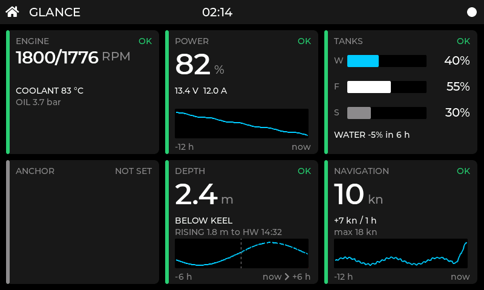
  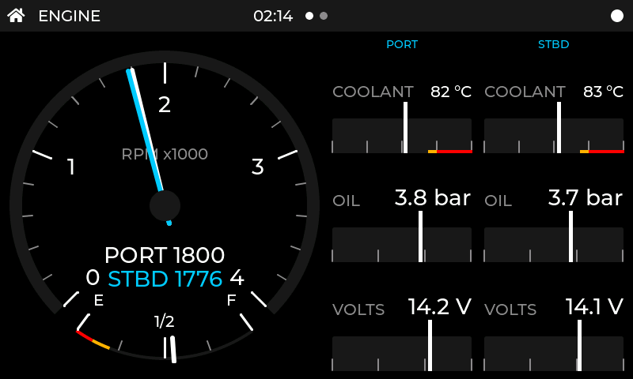
</p>
<p align="center">
  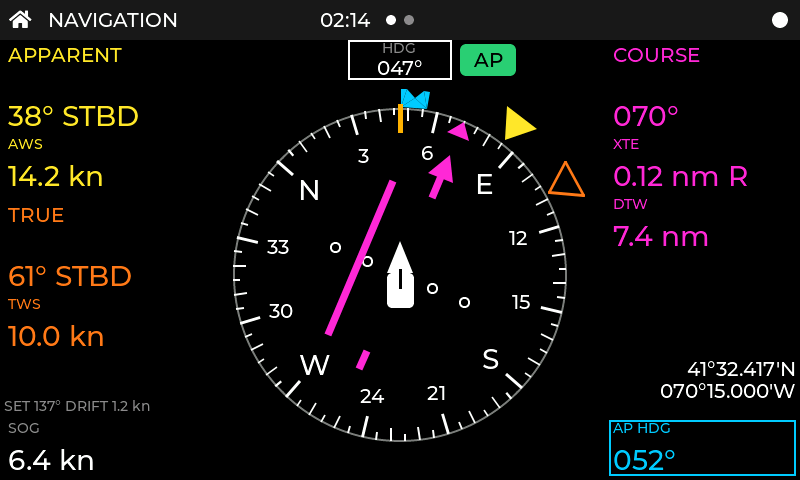
  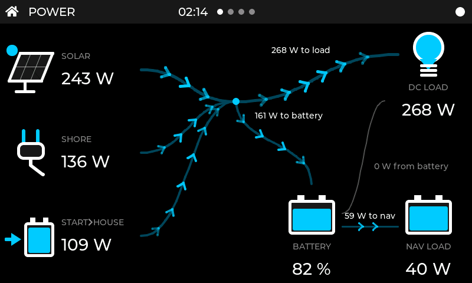
</p>
<p align="center">
  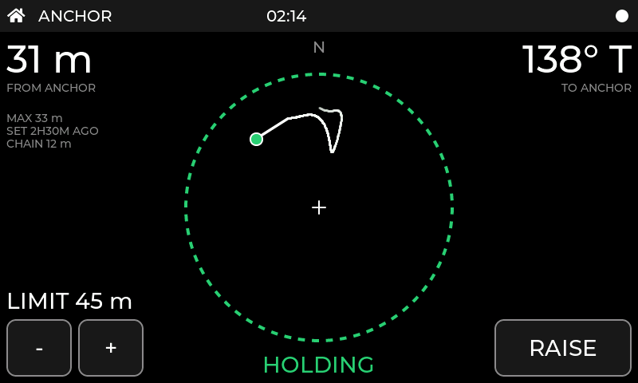
  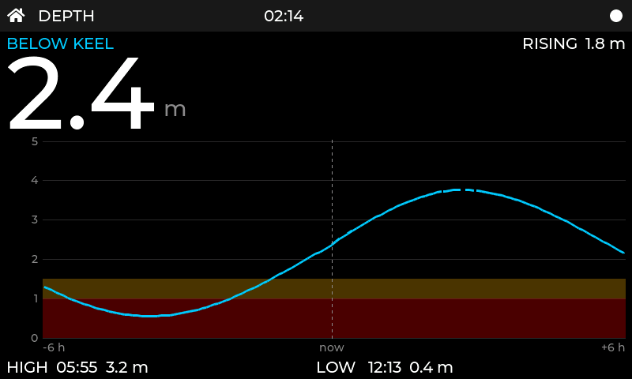
</p>
<p align="center">
  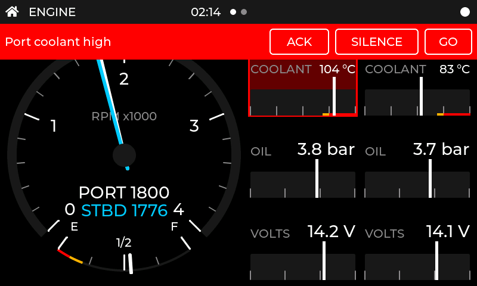
  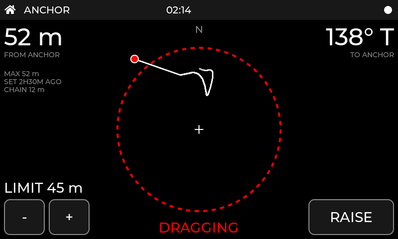
</p>
<p align="center">
  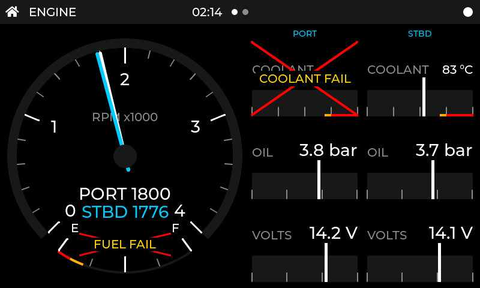
  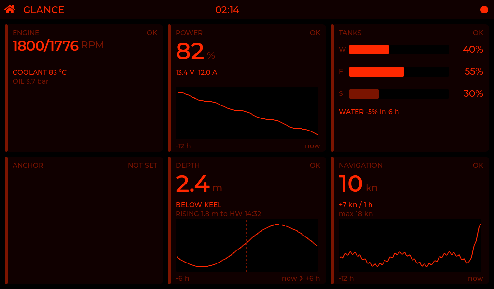
</p>
<p align="center">
  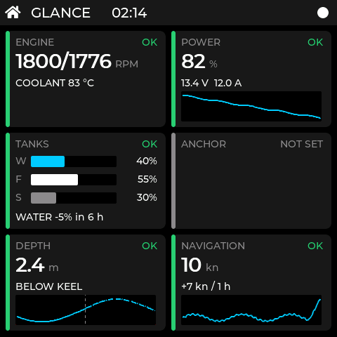
  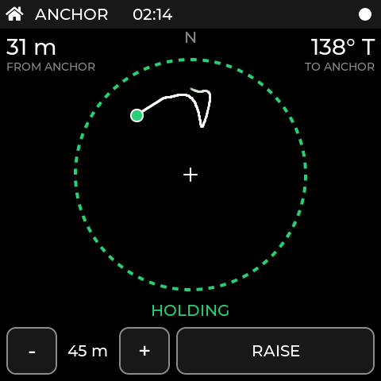
</p>

The fourth row shows alarms: a Signal K coolant alarm raises a banner you can acknowledge, silence or jump from, and the anchor goes red when the boat leaves its circle. The fifth shows a failed sensor, where only the failed fields lose their value and the rest stay live, and the night palette, which is red on black.

## Supported hardware

All three boards are Waveshare ESP32-S3 touch displays with an RGB panel and a GT911 touch controller. A new board is a profile in `boards/`, not a fork.

| Board id | Display | Size |
|---|---|---|
| `square4` | ESP32-S3-Touch-LCD-4 | 4", 480×480 |
| `lcd7` | ESP32-S3-Touch-LCD-7 | 7", 800×480 |
| `lcd7b` | ESP32-S3-Touch-LCD-7B | 7", 1024×600 |

Board notes, pin maps, and bring-up findings are in [docs/hardware/boards.md](docs/hardware/boards.md).

## Try the simulator

You need CMake, Ninja, a C compiler, and the SDL2, libpng, and libcurl development packages (on Debian or Ubuntu: `libsdl2-dev libpng-dev libcurl4-openssl-dev ninja-build`).

```sh
cmake -S sim -B build/sim -G Ninja -DBUILD_TESTING=ON
cmake --build build/sim
ctest --test-dir build/sim --output-on-failure
./build/sim/sim --board sim800 --palette day      # sim480 | sim800 | sim1024; day | dusk | night
./build/sim/sim --snapshot out/snap               # every page as PNG, no window
```

Swipe with the mouse or use the arrow keys. Left and Right change role, Up and Down change page. [docs/testing.md](docs/testing.md) explains how to point the simulator at a Signal K server and play test scenarios.

## Install from your browser

The latest builds can be flashed from a web page, with no tools to install. It needs a desktop Chrome or Edge, a USB cable, and the board that matches your display. It lists two channels: the newest tagged release and a rolling build of the main branch. **Both are pre-release and not fit for use on a boat.** The page is at <https://ryanillman.github.io/saloon-watchkeeper/>.

Settings live on the SD card, so installing a new version keeps them. A board with no SD card starts from the defaults. Enabling the NMEA 2000 bus turns off native USB on the 7" boards: flash those through the UART port.

## Build and flash firmware

You need [ESP-IDF](https://docs.espressif.com/projects/esp-idf/) v5.5.1.

```sh
. ~/esp/esp-idf/export.sh
tools/build-firmware.sh                                   # every board in boards/
idf.py -D BOARD=square4 -B build/square4 build            # one board
idf.py -B build/square4 -p /dev/ttyACM0 flash monitor
```

`tools/build-firmware.sh` also writes a merged image per board to `out/<board>.bin`. Flash that file at offset `0x0`.

## Configure

Settings live in `/config.json` on the display's SD card: Wi-Fi, the Signal K server (the default `auto` finds it by mDNS), units, palette, the ordered list of roles, and which Signal K anchor-alarm plugin the Anchor page talks to (`anchor.plugin`: `hoekens-anchor-alarm`, the default, or `anchoralarm`). Start from [docs/config.example.json](docs/config.example.json). `tools/config.schema.json` is the JSON Schema.

On the display, Setup (the top strip, then the quick panel) edits Wi-Fi, the Signal K server, the data sources, the roles, discovery results and display options, and can request access from the Signal K server in place of a token in the file. The data sources are Signal K only, Signal K with the NMEA 2000 bus as a fallback, or the bus alone (`sources.nmea2000`: `enabled` and `mode`, `fallback` or `only`). The bus setting is read at boot. `sources.nmea2000.ids` maps a bus instance to the id Signal K uses (`engine.0` to `port`); it is edited in the file because its keys contain dots. On the 7" boards the bus turns native USB off. If your Signal K server requires a token you can still put it in the `sources.signalk` section of the file.

## How it is built

- C, ESP-IDF, and [LVGL 9](https://lvgl.io).
- The roles and UI never include ESP-IDF headers, so the same code runs on the display and in the simulator. `tools/check-layering.sh` enforces this, and CI runs it with the tests.
- Data sources write into one path-keyed model. A role never knows which source fed it, which is how NMEA 2000 can arrive without touching the instruments.

Hardware notes and test procedures are in `docs/`.

## Safety

This is a hobby project and comes with no warranty. Do not rely on it for navigation or to protect your engine, batteries, or boat. Keep your primary instruments and alarms as your source of truth.

## Not affiliated

Saloon Watchkeeper is not affiliated with or endorsed by the Signal K project, Victron Energy, Waveshare, or Garmin. Product names are used only to say what the software works with or took inspiration from.

## Related projects

- [Marine-Displays](https://github.com/Boatingwiththebaileys/Marine-Displays) is another set of ESP32 displays for Signal K and NMEA 2000, with a web-driven setup. It is licensed for non-commercial use only.
- [KIP](https://github.com/mxtommy/Kip) is a browser-based Signal K instrument panel.
- [SensESP](https://github.com/SignalK/SensESP) is the usual way to get sensor data from an ESP32 into Signal K.

## License

MIT. See [LICENSE](LICENSE). This is new code and is not derived from any other display firmware.
